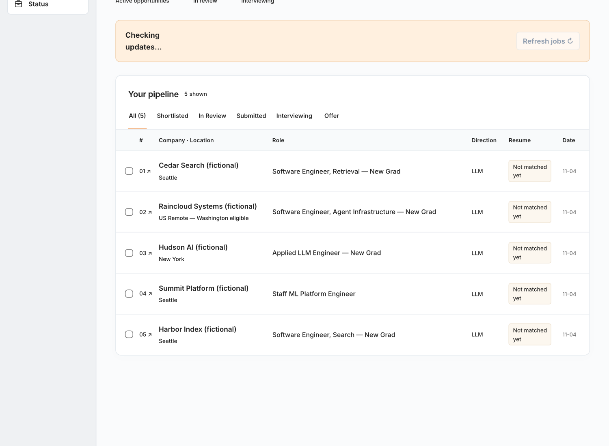

# CareerOS

A local job-search assistant that remembers your preferences and application progress across Codex conversations.



## Quick start

Install [Node.js LTS](https://nodejs.org/en/download) (22 or newer, includes npm). From the repository folder, install dependencies once:

```sh
npm ci
```

Start CareerOS and open it in your browser:

```sh
npm start
```

Add your profile to start your own search, or select **Try example** to explore Alex’s five jobs.

## Repository

```text
CareerOS/
├── data/                             Your data, created when you confirm your profile
│   ├── profile/                      candidate.json and three preference files
│   ├── sessions/                     One conversation per JSON file
│   ├── opportunities/                Jobs, application progress, and drafts
│   └── runtime/                      Task queues and runner state
├── skills/
│   ├── matching/                     Screen jobs against your preferences
│   ├── submission/                   Prepare and review applications
│   └── interview/                    Prepare for interviews
├── src/                              Website, memory, and storage code
├── evaluation/
│   ├── cases/alex/                   Initial data/, scenario, and checkpoints
│   └── runs/alex/<run-id>/           A working copy in data/ and scores in results/ for graded runs
└── docs/workflow-contract.md         Application review and submission rules
```
